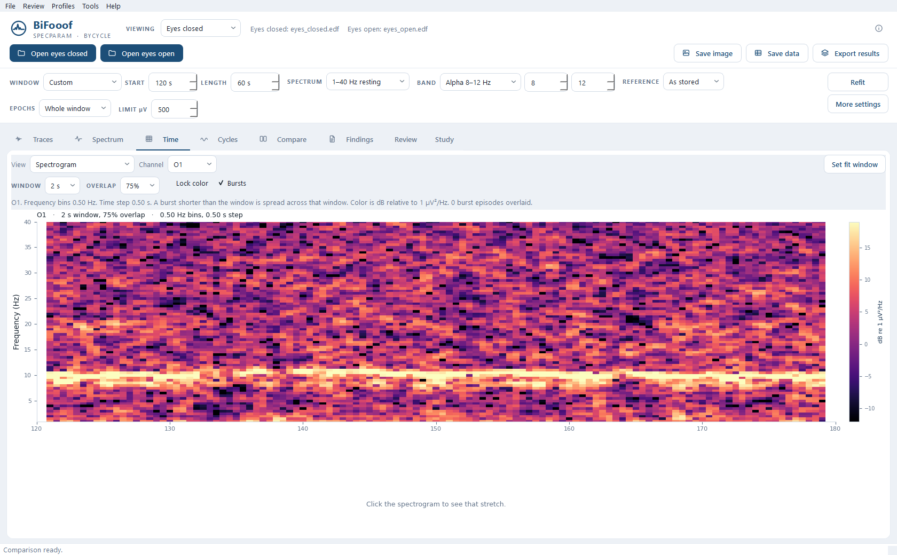
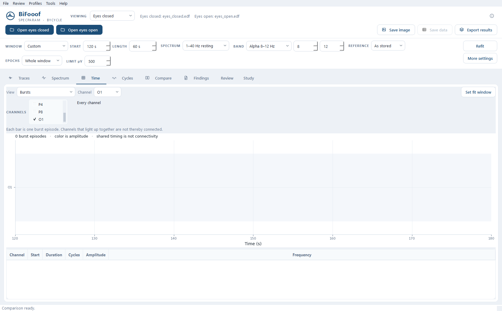
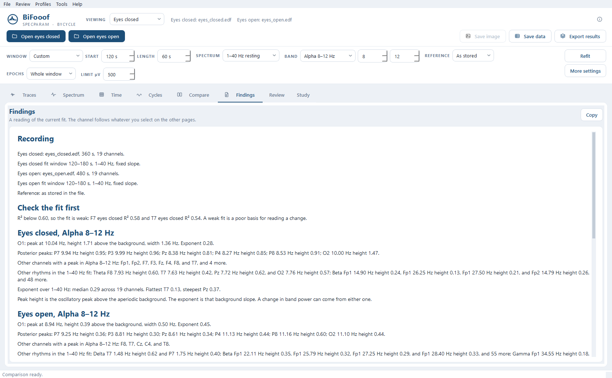
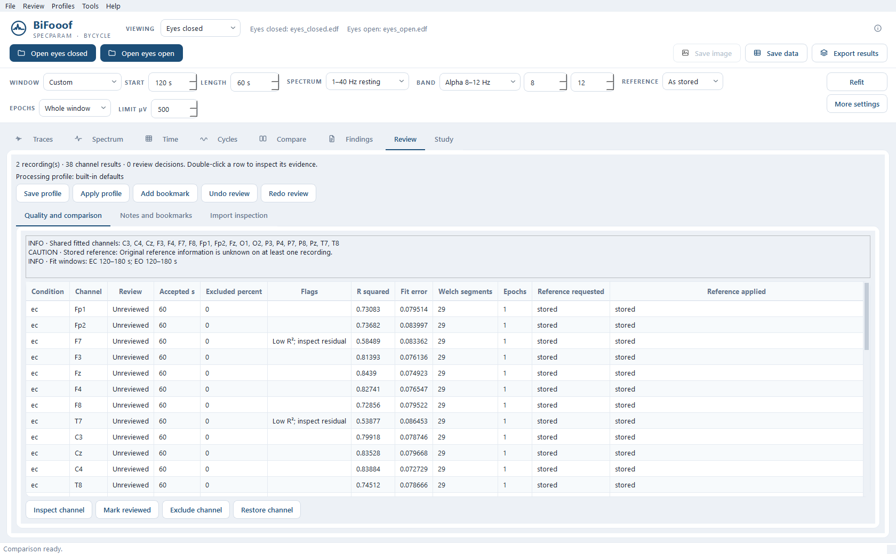
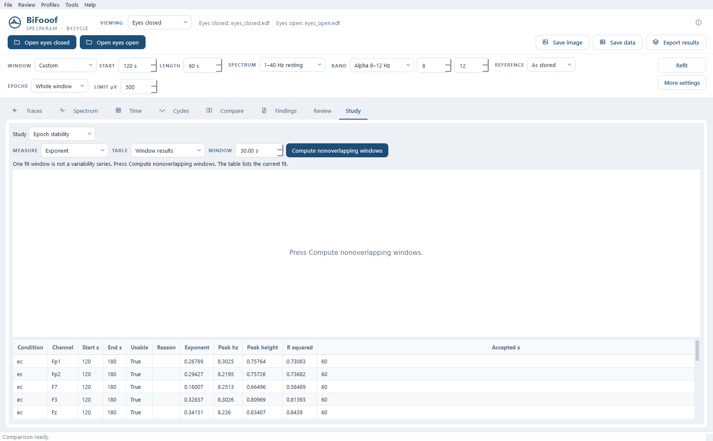

# BiFooof

**EEG spectral and cycle analysis using specparam (FOOOF) and bycycle.**

A Windows app for getting a better look at what's actually going on in the EEG without lumping everything into broad frequency bands.

Specparam separates rhythmic peaks from the aperiodic background, while bycycle looks at the oscillations themselves, their amplitude, timing, shape and how they group into bursts. The idea is to get a more useful picture of the signal rather than relying on consolidated band-power values alone.

Supports EDF, WinEEG `.eeg`, BrainVision, EEGLAB, FIF, CNT, CSV and JSON. The WinEEG reader is built in. BXS needs `bxs2edf.exe` installed locally.

You can load eyes-closed (EC) and eyes-open (EO) recordings together and compare their spectra, peaks, background slopes and alpha reactivity.

## Review workspace · 0.2.0

Save and reopen verified projects with review notes, bookmarks, exclusions,
undo/redo, applied settings and staged edits. Recovery copies, recent projects,
named processing profiles and a synthetic demonstration are available from the menus.

The **Review** page shows usable signal, fit flags, reference and comparison
checks, review status, and original/imported channel information. **Study** adds
nonoverlapping-window stability, individual alpha-band candidates, saved regions,
explicit left/right summaries, editable events and repeated-session trends.
One fit window stays in the Study table. It is not drawn as a variability
series until you press Compute.

Traces retain brief extrema and offer display filters, montages, keyboard paging,
jump-to-time and a sample-based ruler. Long jobs support progress and cancellation;
Time caches have a memory limit. **Tools → Batch queue** runs explicitly assigned
recordings with locked settings and retryable failures.

**Ctrl+S** saves a project; **Ctrl+Shift+E** exports completed results. The report
preview exports offline HTML and PDF alongside the detailed tables and review
sidecars. See [the running guide](docs/running.md) for the workflow and measurement
definitions, and [the completed roadmap](docs/product-roadmap.md) for scope.

## Spectral fitting

The fit controls let you decide what part of the recording to analyze and how specparam handles it.

By default it uses the full recording, 1–40 Hz, a 4-second Welch segment giving 0.25 Hz frequency bins, and a fixed aperiodic slope.

You can change the fit range to 2–40 Hz for EO/EC comparisons, narrow it to 3–30 or 2–20 Hz, or change the Welch segment to 2 or 8 seconds.

Fixed and knee models are available, along with controls for peak width, number of peaks, minimum height and the 2 SD peak threshold.

**Refit** runs specparam and bycycle again using the selected time window and settings. Scrolling through the traces or cycles only changes what's displayed, not the underlying fit.

## Frequency bands

Alpha 8–12 Hz is the default, but you can switch to delta 1–4, theta 4–8, beta 13–30, gamma 30–45 Hz, or enter your own range.

The selected band carries through to the Cycles page and EO/EC reactivity calculations. Changing it doesn't automatically refit the spectrum.

Burst detection can use the standard bycycle library rules or the resting-alpha and paper-alpha amplitude rules. Whichever rule you choose applies to the selected frequency range.

## Drift, artifacts and burst detection

Both spectral and cycle analysis remove a straight-line drift from each channel before processing. Welch uses the detrended signal for its power estimate, while bycycle detrends before bandpass filtering.

Rejected samples stay rejected. BAD annotations, marked bad channels and nonfinite samples are excluded rather than replaced with zeros. Cycles aren't allowed to cross rejected gaps.

If cycles are detected but don't form a qualifying burst, the Cycles page shows which threshold stopped them. The library rule requires monotonicity above 0.8 across three consecutive cycles.

Burst counts are separated into two measurements:

- **Burst cycles:** Individual cycles meeting the burst criteria.
- **Burst episodes:** Separate continuous runs of qualifying cycles.

That way you can distinguish a rhythm producing plenty of individual cycles from one that actually holds together for sustained periods.

## EO/EC states and comparison

WinEEG files containing eyes-open or eyes-closed marks can be split into their respective states. If both are present, both can be loaded from the same recording.

Clock-time marks are preserved as notes rather than treated as state boundaries. Separate EO and EC files still work normally.

The comparison keeps two measurements separate.

**Peak Δ** is the EC fitted peak height minus the EO fitted peak height, measured above the aperiodic background in log10 power. Each state uses its own detected peak. If a peak isn't present, the value stays missing. The command line and the window report that same peak. Width is the two-sided bandwidth, in the same Hz as the width control.

**Δ band %** compares mean Welch power within the selected band:

`(EC − EO) / EO × 100`

That's the percentage change between recordings, not the percentage of total spectral power occupied by the band. If EO power is missing or nonpositive, the result stays blank.

The Spectrum page's Height column reports fitted peak height, not total Welch band power.

This lets you check whether alpha attenuation during EO, or an increase during EC, is coming from a more prominent oscillatory peak or a broader change in spectral power.

## Epoch analysis

You can analyze the whole selected window or break it into non-overlapping 30- or 60-second epochs.

Each epoch gets its own spectral fit.

Peaks with centers within 1 Hz are grouped, and their reported frequency, height and width are calculated from the median of the epochs containing that peak.

If an epoch doesn't contain the peak, it isn't counted as zero. This keeps an intermittent rhythm from appearing artificially weaker simply because it wasn't present throughout the recording.

The caption tells you how many epochs actually contained an in-band peak.

Offset, exponent and R² are calculated from the medians of successfully fitted epochs. Spectrum and model curves are averaged in linear power, then displayed in log10 units.

Changes to epochs, reference or amplitude limits require **Refit**.

## Fit quality and signal checks

The app also flags measurements that need a closer look.

Fits with R² below 0.6 are ringed on the head map. Peaks sitting against the minimum allowed width are marked.

Recordings with suspicious voltage scales are flagged beside the filename rather than silently rescaled.

The active reference is shown in the Spectrum and Compare captions. By default, the app uses the reference stored in the recording.

These checks matter because a clean-looking graph doesn't necessarily mean the fit or the original signal is reliable.

## Time analysis

The Time tab uses the same recording window, reference and accepted samples as the spectral analysis.

The default view is a spectrogram showing how power changes across frequency and time, with detected burst episodes overlaid when available. The burst channel list follows a single selected channel and scrolls that row into view. A list with several checks stays as you set it.

Clicking a point in time moves the trace display to that location. **Set fit window** sends the selected interval to the fit controls, but you still need to press Refit to recalculate the analysis.

Other views include:

- Sliding-window specparam fits to track exponent and peaks over time.
- Burst timelines, episode lengths and cycle morphology.
- Cycle amplitude against frequency.
- Band-power changes around actual EO/EC event marks.
- Coherence and phase–amplitude coupling.
- Signal-quality and rejected-sample timelines.

Separate EO and EC recordings aren't treated as though a real-time transition occurred between them.

Coupling analysis runs separately from the normal refit and warns when there isn't enough usable recording time.

## Saving and exporting

Session exports include `metadata.json`, the spectrum CSV and a separate table containing one row per fitted peak.

Exports are prepared in a temporary folder before replacing the previous result bundle. Reusing a folder removes obsolete BiFooof output files, keeps unrelated files, and writes `bifooof-manifest.json` last. Metadata includes the accepted samples and source-time intervals for each fitted channel, along with the reference actually applied.

This keeps the measurements alongside the settings used to generate them, making it easier to compare recordings or check results later.

## What it's useful for

Mainly looking at amplitude and frequency distributions in more detail without bunching all the activity into one band value.

You can see where rhythmic peaks sit against the background slope, how stable those peaks are, and whether the underlying oscillations are sustained or only appearing in short bursts.

It could be useful for checking EO/EC alpha reactivity, looking at differences between sites, investigating unusual band-power distributions or seeing what actually changed between recordings and training sessions.

It's an analysis tool, not an automatic diagnosis or protocol generator. The measurements still need to be checked against the raw EEG, recording conditions, artifacts and clinical context.

## Documentation

The controls and calculations are documented in [docs/running.md](docs/running.md).

That document should be updated whenever the interface or processing changes.

Version 0.2.0 is the review workspace above. Wrapping controls, the advanced-settings
foldout, pending and invalid settings, keyboard shortcuts, and file-error dialogs
are described in the [controls and feedback guide](docs/running.md#controls-and-feedback).
Closing during background work stays responsive.

The [code walk and improvement backlog](docs/code-walk.md) maps the code and
records the resolved findings and their regression coverage. Run the tests
with `python -m unittest discover -s tests -v`. Windows CI runs the same suite.

The [feature roadmap](docs/product-roadmap.md) reviews useful additions for
daily EEG review, reproducible projects, comparisons, reporting, and larger
workloads, with suggested implementation order and completion checks.

## Screenshots

The screenshots use a 60-second section of eyes-closed and eyes-open EDF recordings, from 120–180 seconds. The files are shown as `eyes_closed.edf` and `eyes_open.edf`.

Traces is a 15-second page at 100 µV, from 158–173 seconds, with O1 selected. Spectrum, Cycles, Compare, and Findings are that same O1 fit: a 10 Hz peak with eyes closed, a smaller peak near 9 Hz with eyes open, and no library bursts. Time shows the spectrogram, then the burst row on the 120–180 second clock. Review flags the weak eyes-closed fits. Study lists the one fit window and waits for Compute before drawing a variability series.













## Run from source

```text
pip install -r requirements.txt
python -m bifooof
```

To reproduce the tested direct dependency versions on Python 3.12, install with
`python -m pip install -r requirements.txt -c constraints-tested.txt`.

From a command prompt:

```text
python -m bifooof info FILE
python -m bifooof run FILE --condition ec --channel O1 --out bifooof-out
python -m bifooof compare --ec EC_FILE --eo EO_FILE --channel O1 --out bifooof-out
python -m bifooof formats
```

`--band` sets the cycle band: `delta`, `theta`, `alpha`, `beta`, `gamma`, or a range such as `8-12`. `--alpha LOW HIGH` sets the reactivity peak. In the window those two stay on the same band.

## One file

```text
pip install pyinstaller
pyinstaller bifooof.spec
```

The result is `dist\BiFooof.exe`. Copy that file by itself. Double-click it for the window. From a command prompt the same file runs `info`, `run`, `compare`, and `formats`. The first launch unpacks into a temporary folder, so the window takes a little longer to appear. WinEEG `.eeg` reading is inside the file. BXS still needs `bxs2edf.exe` on the machine.
