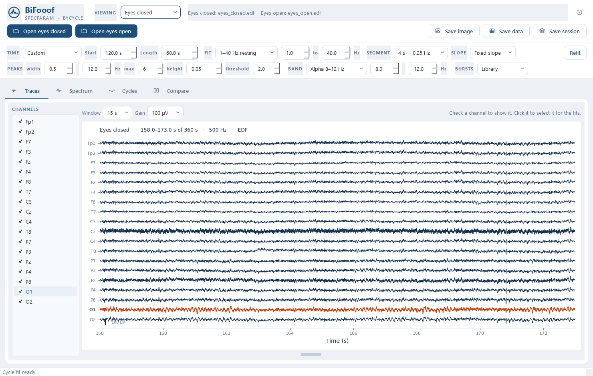
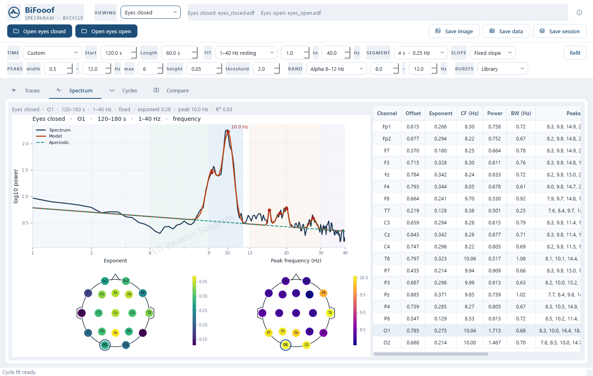
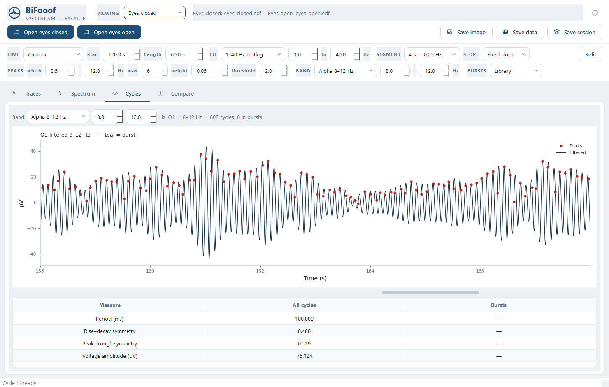
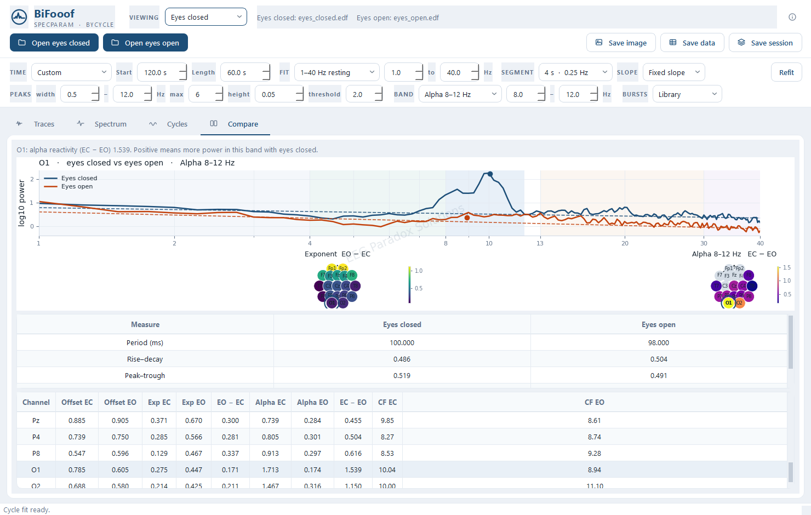

# BiFooof

Windows app for specparam (FOOOF) and bycycle on EEG.

Open an EDF, WinEEG `.eeg`, BrainVision, EEGLAB, FIF, CNT, CSV, or JSON file. BXS files need `bxs2edf.exe` on the machine. Open an eyes-closed recording and an eyes-open recording together and the comparison view puts the two spectra side by side.

## Fit bar

specparam fits a stretch of the recording and reports the aperiodic slope and the peaks. The default is the whole file, 1–40 Hz, a 4 second Welch segment (0.25 Hz bins), and a fixed slope.

The fit bar can switch that to the published 2–40 Hz eyes-open / eyes-closed range, a narrower 3–30 or 2–20 Hz band, a 2 or 8 second segment, and a knee instead of a fixed slope. Peak width, count, height, and the 2 SD peak threshold are on that bar too.

**Refit** runs specparam and bycycle on the time window you set. The scrollbars on the trace and cycle pages only move the picture.

## Band

Alpha, 8–12 Hz, is the default. The same control is delta 1–4, theta 4–8, beta 13–30, gamma 30–45, or any range you type. The Cycles page and the eyes-closed versus eyes-open reactivity both follow it. Changing the band does not refit the spectrum.

Burst detection can stay on the library rule, or use the resting-alpha and paper-alpha amplitude rules. Those rules still apply to whichever band is selected.

Plots in the window and saved images carry an EEG Paradox Solutions watermark.

## Screenshots

These are a 60 second section of an eyes-closed and eyes-open EDF, from 120 s to 180 s. The names in the title bar are placeholders. The trace page is 158–173 s, where the occipital 10 Hz rhythm is strongest. Nothing identifying was left in the window.









## Run from source

```text
pip install -r requirements.txt
python -m bifooof
```

From a command prompt:

```text
python -m bifooof info FILE
python -m bifooof run FILE --condition ec --channel O1 --out bifooof-out
python -m bifooof compare --ec EC_FILE --eo EO_FILE --channel O1 --out bifooof-out
python -m bifooof formats
```

`--band` sets the cycle band: `delta`, `theta`, `alpha`, `beta`, `gamma`, or a range such as `8-12`. `--alpha LOW HIGH` sets the reactivity peak. In the window those two stay on the same band.

## One file

```text
pip install pyinstaller
pyinstaller bifooof.spec
```

The result is `dist\BiFooof.exe`. Copy that file by itself. The first launch unpacks into a temporary folder, so the window takes a little longer to appear.
