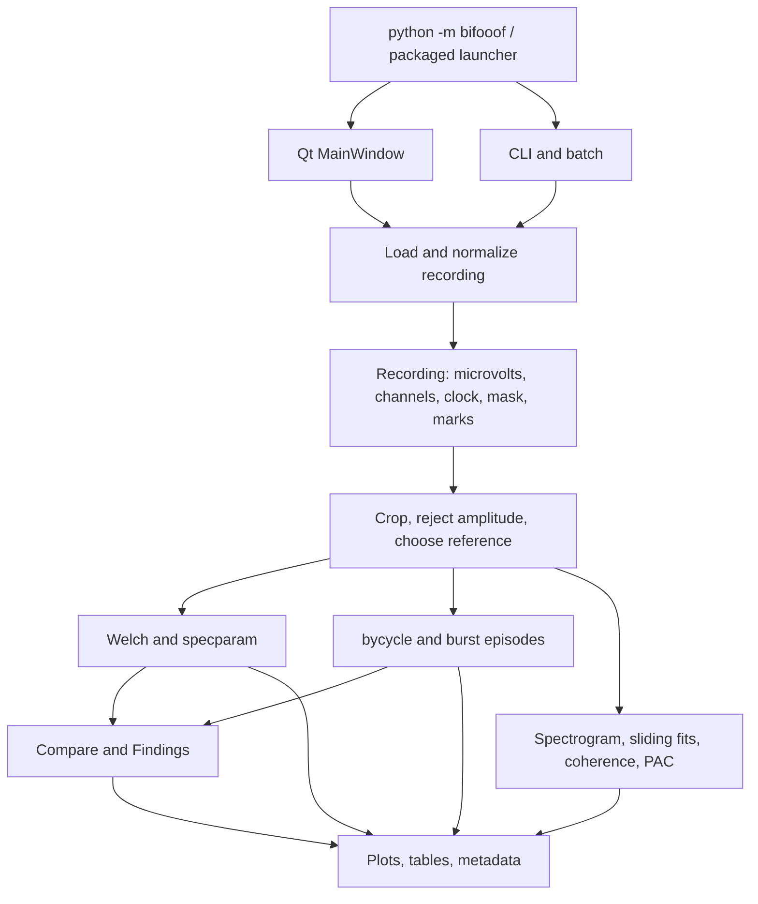

# BiFooof code walk and resolved findings

Reviewed on 2026-10-23 against commit `ed981a7` on
`cursor/exclude-artifacts-and-name-measures`.

All 14 confirmed findings below were fixed in version 0.1.4. Version 0.1.5
added desktop polish. Version 0.2.0 implements the fourteen additions in
[product-roadmap.md](product-roadmap.md), prioritizing individual EEG and EC/EO
review; [running.md](running.md) documents the current behavior.
The suite now has 125 normal passing tests: the previous 95 plus 30 workflow
regressions. There are no expected failures.

The original priorities and reproductions are retained below as a record of
the reviewed revision. Their source line numbers refer to that baseline;
implementation has since moved some functions. Two initial test fixtures were
corrected during implementation: Beta is selected by its visible label, and
the PAC map is compared with a selected calculation using identical band edges.

## Scope and validation

The reviewed baseline had 45 Python source files and 11,664 source lines, excluding
tests, generated build files, and local results. The walk followed the loader,
preparation, spectral/cycle/time analysis, GUI worker/state, comparison, and
export paths. It also inspected the command entry points, packaging recipe,
documentation, and existing tests.

Validation used synthetic signals, synthetic WinEEG bytes, MNE RawArray objects,
temporary exports, and offscreen Qt widgets. No personal EEG recordings were
opened or modified. Worker-order tests simulate completion order without
launching threads, making the race reproducible.

Verified environment: Python 3.12.10; NumPy 1.26.4; SciPy 1.16.2; MNE 1.10.1;
Matplotlib 3.10.7; PySide6 6.11.0; pandas 2.3.3; specparam 2.0.0rc7;
bycycle 1.2.0.

Run everything from the repository root:

```powershell
python -m unittest discover -s tests -v
```

The expected result after the fixes and feature release is **125 passing tests, no failures, errors,
or expected failures**. Run the review/integration cases alone with:

```powershell
python -m unittest discover -s tests -p test_review_regressions.py -v
```

Local review evidence lives under the ignored `runs/code-walk/` directory:
`test-output.txt` and `evidence.json` contain test results, dependency versions,
and the source inventory. The durable
regression cases are in [test_review_regressions.py](../tests/test_review_regressions.py).

The Windows executable is rebuilt for each delivery. The 0.2.0 packaged checks
cover:
version, formats, CSV info, offset FIF info, offset FIF spectral/cycle export,
matched-duration JSON comparison, an imported processing profile and verified
QtWidgets/offscreen-platform GUI initialization. The ZIP contains
that executable. Packaged evidence is saved in `runs/code-walk/exe-smoke.json`.
The polish pass also checked the actual offscreen Qt interface at 1180×780
and 1560×1020 using synthetic EEG, including advanced settings, comparison
titles, and wrapping controls in every Time mode. Local screenshots and build
evidence are in `runs/polish/`.
This was not a fresh dependency installation, a manual
test of every screen at different display scales, or validation of every vendor
format. A generated long-recording benchmark is recorded for 0.2.0 below.

## How the application fits together



The strongest architectural choice is the shared `Recording` and preparation
path. Spectra, cycles, and most time analyses already agree on the basic signal
representation. The main weaknesses found were preserving source-time provenance,
keeping derived results attached to the exact inputs/settings that generated
them, and sharing the same orchestration rules between GUI and CLI.

### Entry points and batch execution

- `bifooof/__main__.py` chooses GUI for no arguments or `gui`, and forces the
  Agg backend for command-line work. `launch.py` is the PyInstaller entry.
  `__init__.py` stores the package version.
- `cli.py` parses `info`, `run`, `compare`, and `formats`, builds `FitSettings`,
  and reports per-file errors for batch runs.
- `batch.py` loads recordings, chooses channels, runs analyses, and writes
  outputs. GUI and CLI now share window matching and transactional exports.

### Recording input and provenance

- `io/sniff.py` recognizes extensions and WinEEG magic, and resolves
  BrainVision data/header pairs.
- `io/load.py` adapts MNE readers, built-in WinEEG, optional BXS conversion,
  CSV, and JSON. `finalize()` converts to the common shape, cleans names,
  removes duplicates/auxiliary channels, prefers the standard 19, retains ear
  references, and preserves exclusions as NaN plus a validity mask.
- `io/wineeg.py` parses the recovered legacy binary layout, channel scaling,
  sample frames, and primary/extended marks.
- `io/recording.py` defines `Recording` and `Mark`; cropping slices data,
  reference channels, masks, spans, and marks.
- `io/channels.py` handles aliases and montage selection. `io/condition.py`
  recognizes EC/EO text. `io/marks.py` selects the longest marked span for each
  eye state. `io/__init__.py` is package scaffolding.

Input-time semantics deserve the first fixes: downstream analyses cannot
recover a dropped mark, a compressed CSV gap, or a wrongly placed exclusion.
The longest-span policy is intentional current behavior; multiple same-state
segments are not concatenated.

### Common preparation and numerical analysis

- `analysis/settings.py` contains fit choices, presets, window bounds, and
  the GUI's shorter-recording matching helper. `prepare.py` crops, rejects
  amplitude outliers before referencing, and applies stored/average/linked
  reference. `segments.py` identifies contiguous accepted runs and merges
  overlapping burst coverage.
- `analysis/spectra.py` computes Welch power on accepted runs with linear
  detrending. `specparam_fit.py` fits groups, falls back to individual channels,
  records curves/quality, and combines epoch results. In-band peak counts stay
  separate from peak heights.
- `analysis/compare.py` matches channels by name and separates fitted peak
  height from Welch band power. Its missing-peak handling is already tested.
- `analysis/cycles.py` runs bycycle independently on accepted stretches,
  translates sample landmarks, and produces cycle rows, burst cutoffs,
  episodes, and occupancy. Gap boundaries are preserved.
- `analysis/timefreq.py` provides spectrograms, sliding fits, peak tracks,
  exponent spread, block power, and event alignment. `coherence.py` combines
  spectra on samples shared by two channels and computes phase/imaginary
  coherence/wPLI. `pac.py` computes the modulation index, shifted surrogates,
  and an optional map.
- `analysis/shape.py` derives morphology, amplitude-frequency clouds, and
  burst-duration summaries from existing cycle fits. `quality.py` proposes
  quality spans and makes session copies with selected exclusions.
- `analysis/findings.py` turns existing measurements into text; it does not
  run a separate classifier. `analysis/__init__.py` is package scaffolding.

Keep preparation centralized. Fix the numerical aggregation and channel
selection issues before adding more derived measurements.

### Desktop state, jobs, and rendering

- `ui/app.py` initializes Qt, styling, and Windows identity. `main_window.py`
  owns recordings, original sources, the optional continuous marked source,
  selection, panel synchronization, and session export.
- `ui/workers.py` runs callables in QThreads, retains live workers, emits
  results/errors, and waits during shutdown.
- `ui/fit_bar.py` stages settings until Refit and emits live band changes.
  `trace_panel.py` draws the original recording and keeps display scrolling
  separate from the analysis window.
- `ui/spectrum_panel.py` owns spectrum jobs/results per condition.
  `cycle_panel.py` owns the selected channel's cycle job.
  `compare_panel.py` matches two spectral fits and computes paired cycles.
- `ui/time_panel.py` coordinates ten time modes, their controls, job/cache
  state, inspection cursor, event source, exclusions, captions, and rows.
  At 1,771 lines it is the largest concentration of state and responsibilities.
  `time_draw.py` contains the corresponding plotting functions.
- `ui/findings_panel.py` renders escaped report text and supports copying.
  `canvas.py` embeds Matplotlib; `headmap.py` draws electrode maps;
  `icons.py` and `theme.py` supply presentation assets. `ui/__init__.py` is
  package scaffolding.

Generation counters protect several job paths, but a generation must also
change when the selected view can be satisfied locally or from cache. A result
should carry its submitted request key rather than deriving that key from
whatever controls happen to be selected when it finishes.

### Exports, figures, and packaging

- `export.py` serializes spectra, peaks, comparisons, cycle summaries/details,
  episodes, and metadata. `session_export.py` stages and publishes result
  bundles for GUI and CLI. `plots.py` shares the principal figures between
  GUI and CLI. The Time renderers remain in `ui/time_draw.py`.
- `bifooof.spec` builds a one-file Windows executable with explicit lazy MNE
  imports/data and Matplotlib backends. It also excludes several large optional
  packages. Format-specific packaged smoke tests are needed, especially for
  reader paths requiring optional dependencies.
- `requirements.txt` pins specparam/bycycle and uses lower bounds for the
  other dependencies. `constraints-tested.txt` records the tested direct
  dependency stack; it is not a full transitive lockfile. Windows CI in
  `.github/workflows/tests.yml` installs that stack and runs the complete suite.
  CI has not been run remotely as part of this local change.
  `tests/test_review_regressions.py` extends the original synthetic/offscreen
  coverage to the boundary cases below.
- `README.md` is the overview. `docs/running.md` describes current controls;
  `docs/additional-graphs.md` is the historical feature plan. Prefer the running
  guide when the two disagree. Generated `build/`, `dist/`, and `runs/` are
  ignored by git.

## Resolved findings from the baseline

P1 means fix before adding analysis features because the case can admit rejected
data, alter time, or report the wrong numerical quantity. P2 means a concrete
workflow, consistency, or output bug that should follow. The R identifiers match
test names in `tests/test_review_regressions.py`.

Completed changes:

- R01/R02/R03/R04/R05: MNE local annotation clocks and events, WinEEG artifact
  masks, state-only boundaries, and rejection of discontinuous CSV time.
- R06/R07: arithmetic linear-power epoch aggregation; the PAC grid uses the
  selected phase/amplitude channels and the selected estimator's edge handling.
- R14: explicit source offsets and projection of masks from both split
  conditions onto the continuous event recording, including restore.
- R11/R12/R13: invalidation on cached/local view changes, submitted request
  keys, copied settings snapshots, live Time bands, and immediate removal of
  pending/failed spectral results from dependent views and exports.
- R08/R09: per-channel contributing intervals/counts, effective references,
  epoch-tail accounting, and matching GUI/CLI paired windows for spectra/cycles.
- R10: `session_export.py` stages complete output bundles, removes obsolete
  canonical app files, retains unrelated files, rolls back ordinary publication
  failures, and writes the completion manifest last.

The following symptoms and fix guidance describe the original findings.

### R01 — P1: MNE BAD annotations use the wrong clock on offset recordings

**Location:** `io/load.py:239–271`, especially the onset-to-sample conversion.

`_recording_from_raw()` multiplies annotation onset directly by the sampling
rate. With a nonzero `raw.first_time`, that onset is not local sample-zero time.
The reproduction uses a RawArray starting at sample 1000 at 100 Hz, with a BAD
interval at local 1–2 s. The resulting recording accepts samples 100–199; the
exclusion was moved beyond the recording.

**Fix direction:** normalize all MNE annotation times to the loaded raw's local
clock before constructing masks/spans/marks. Retain duration and channel-specific
scope. Test cropped FIF data as well as an offset RawArray.

### R03 — P1: WinEEG artifact intervals are parsed but remain accepted

**Location:** `io/load.py:273–314`; extended mark decoding in `io/wineeg.py`.

The reader recognizes a kind-0 extended mark as a duration-bearing Artifact,
but `_load_wineeg()` only attaches it to `recording.marks`. It never converts
that interval into a validity mask or rejected span. A synthetic 2–3 s Artifact
mark leaves every corresponding sample accepted, so it can enter spectra and
cycles.

**Fix direction:** carry the parser's artifact kind through loading and apply
its duration to the exclusion mask. Do not rely on the user-visible label alone
to distinguish a state/event note from an artifact.

### R05 — P1: CSV timestamp gaps are silently compressed

**Location:** `io/load.py:408–442`.

The loader checks that time increases, then infers one rate from the median
step. It does not validate uniform spacing or preserve gaps. Times
`0.00, 0.01, 0.02, 10.03, 10.04` become five adjacent 100 Hz samples, with no
warning or gap. Every downstream duration, frequency calculation, and cursor
then uses the compressed clock.

**Fix direction:** reject nonfinite/irregular time columns with a useful error
until explicit gap representation or resampling exists. Allow a documented
tolerance for ordinary timestamp rounding.

### R06 — P1: epoch band power becomes a geometric mean

**Location:** `analysis/specparam_fit.py:334–379` and
`analysis/compare.py:82–96`.

Epoch spectra are already log10 values when `_combine_channel()` averages
them. `band_power()` exponentiates that average and reports it as mean linear
Welch power. Equal-duration epochs with powers 1 and 100 therefore produce 10,
rather than the arithmetic mean 50.5. This changes the reported band percent
comparison when power varies across epochs.

**Fix direction:** preserve arithmetic mean linear PSD for power calculations.
Keep median peak parameters and their epoch counts independent. If the display
continues to average log spectra, store that display curve separately and name
both quantities explicitly.

### R07 — P1: a cross-channel PAC map ignores the amplitude channel

**Location:** `analysis/pac.py:157–161`, `206–240`.

The selected-band index correctly uses `amp_index`, but the map calls `_grid()`
with `phase_signal` alone. Both phase and amplitude for the map are extracted
from that one channel. In the reproduction, changing the amplitude source from
O1 to a strongly modulated O2 changes the selected index while leaving the map
identical.

**Fix direction:** pass both signals into the grid and apply the same channel,
mask, band, and edge-handling rules as the selected estimate. Label both channel
names in the result and exported provenance.

### R14 — P1: event reactivity reintroduces session-excluded samples

**Location:** `ui/main_window.py:411–430`, `ui/main_window.py:514–517`, and
`ui/time_panel.py:1563–1597`.

Session exclusions change the split condition recording. Event reactivity
instead reads `self.continuous`, the original recording retained before the
split. Those session edits are not transferred to it. A block wholly inside a
user-excluded 2–4 s interval still gets a finite event-power value.

**Fix direction:** preserve explicit source offsets for split recordings and
project session masks back onto the continuous source used for events. Apply
the confirmed masks before computing either event power or event parameters.

### R11 — P2: an old Time job can overwrite a cached view

**Location:** `ui/time_panel.py:420–470`.

`_kick()` returns early for cache hits and local modes before incrementing
`_generation`. Start a trajectory calculation, switch back to a cached
spectrogram, then let the trajectory finish: `_done()` accepts it and stores
the SlidingFit under the current spectrogram cache key. The correct cached view
is replaced by the wrong result type.

**Fix direction:** invalidate outstanding requests on every view/input change.
Capture the request key and mode at submission and validate both at completion.
Clear the exposed result on a new computation or failure, or explicitly mark
the previous result as belonging to the previous request.

### R13 — P2: a failed replacement spectrum remains available through `fits`

**Location:** `ui/spectrum_panel.py:87–102`, `146–184`.

Starting a replacement for an existing condition does not always remove that
condition from `fits`, notably when loading its partner triggers shorter-window
matching. On failure, `_failed()` clears the selected `fit` but leaves the old
entry in `fits`. Compare and session export can still consume that entry.

**Fix direction:** invalidate the derived fit at job submission and failure,
and notify dependent views on invalidation as well as success. If old results
are retained for display, keep them separate from current exportable results.

### R04 — P2: a clock note can truncate an EC/EO span

**Location:** `io/marks.py:37–71`.

For a state mark without a duration, the end is the next mark of any kind.
With EC at 0 s, a clock note at 2 s, and EO at 8 s, EC lasts 2 s instead of 8 s.
The existing clock-mark test covers a file containing only a clock note, so it
does not catch the mixed case.

**Fix direction:** choose the next relevant state boundary, preserving unrelated
notes without letting them terminate the state. Add tests combining primary,
extended, clock, and state marks.

### R02 — P2: MNE event and eye-state annotations are discarded

**Location:** `io/load.py:239–271`.

The MNE adapter reads descriptions only to create BAD masks. It returns no
`Mark` objects for ordinary annotations. An EDF-like RawArray containing EC at
0 s and EO at 4 s loads with an empty mark list, preventing marked splitting
and event reactivity for these otherwise supported inputs.

**Fix direction:** preserve ordinary annotations with local onset, duration,
and label, while handling BAD status separately. Reuse the same event contract
as WinEEG rather than adding format-specific logic to the UI.

### R09 — P2: CLI comparisons use different whole-recording durations

**Location:** `batch.py:140–153`; compare with
`analysis/settings.py:202–217` and `ui/spectrum_panel.py:155–158`.

The GUI uses `matched_settings()` for paired whole-recording fits. The CLI
passes the original settings to both. A 20 s EC and an 8 s EO therefore export
20 s versus 8 s from the CLI, while the GUI matches them to 8 s.

**Fix direction:** put paired window resolution in a shared analysis service
and use it for spectra, cycles, Time comparisons, and metadata. Preserve the
existing policy that explicitly selected windows are not automatically changed.

### R12 — P2: the Time band does not reliably follow live band changes

**Location:** `ui/main_window.py:578–588`; Time settings are normally updated
by `_apply_fit()` at line 567.

The live band handlers update Cycles, Spectrum, and Compare, but do not notify
Time. Before the first Refit, selecting Beta leaves Time's settings at Alpha.
After a Refit some settings objects are shared and mutated by reference, which
can change values without recomputing the existing Time result.

**Fix direction:** distinguish staged fit settings from the live selected band,
publish band changes to every consumer, and invalidate only the computations
that actually depend on it. Avoid relying on shared mutable settings objects
to propagate changes.

### R08 — P2: metadata counts input samples instead of analyzed samples

**Location:** `export.py:208–252` and its GUI/batch callers.

`fit_metadata()` counts the recording supplied by its callers, which is normally
the full input, before cropping, amplitude rejection, and reference-induced
nonfinite values. A 12 s recording fitted over 2–6 s with one rejected sample
reports 12 s accepted, instead of 3.99609375 s in this single-channel example.

**Fix direction:** return preparation provenance with each fit. Export effective
per-channel accepted duration/counts, actual contributing stretches/epochs,
source offsets, and the applied reference. Keep whole-input counts explicitly
named if they are also useful.

### R10 — P2: reusing an export folder leaves obsolete optional outputs

**Location:** `batch.py:109–111`, `168–169`, and the similar optional output
branches in `ui/main_window.py:292–294` and subsequent cycle exports.

Peak, cycle-detail, and episode tables are written only when they have rows.
If an earlier run wrote `peaks.csv` and a later run in the same folder finds no
peaks, the earlier table survives next to the new metadata and spectrum.

**Fix direction:** give each run a unique folder, or manage a manifest and
replace every application-owned output for that run, including valid empty
tables. Do not delete unrelated user files. Write the completed bundle from a
staging directory so interrupted/failed analyses do not look like a complete
new session.

## Original improvement sequence and remaining refactoring

Steps 1–4 are implemented. The Windows CI, tested constraints, and local
build/smoke checks in step 6 are included. Broader TimePanel decomposition,
performance work, clean-machine validation, and every-vendor fixture coverage
remain future work rather than additional confirmed bug fixes.

1. **Protect input data and clocks.** Fix R01, R03, R05, R04, and R02. Establish
   one annotation contract and explicit source offsets for cropped/split data.
   Then fix R14 using those offsets. Keep the accepted-run tests intact.
2. **Correct and unify measurements.** Fix R06 and R07. Resolve paired windows
   once for GUI and CLI (R09). Keep fitted peak height, linear PSD, and burst
   occupancy as distinct quantities with explicit units.
3. **Make derived state trustworthy.** Fix R11, R13, and R12. Use immutable
   request snapshots containing recording identity, condition, settings, band,
   and source mask revision. Keep result state separate from in-progress work.
4. **Make exports reproducible.** Fix R08 and R10. Save the effective preparation
   provenance, source clock, both channel names for cross-channel measures,
   and a manifest identifying the completed outputs.
5. **Refactor behind the now-tested contracts.** Extract Time job dispatch,
   result serialization, session masks, and event calculations from
   `TimePanel`. Extract paired analysis orchestration shared by `MainWindow`
   and `batch.py`. Keep plotting helpers focused on rendering.
6. **Add repeatable project checks.** Add Windows CI running the unittest
   command above; capture a reproducible dependency set; build/smoke-test the
   executable against synthetic fixtures. Keep small format fixtures for
   supported reader variants and test each advertised packaged format.

All review expected-failure decorators have been removed. Future fixes should
add normal regression tests and keep the complete suite passing. Update
`docs/running.md` when the controls or calculation contract changes.

## 0.2.0 verification and remaining validation scope

The follow-up work now includes cooperative job cancellation, progress,
bounded pending requests and a 128 MiB LRU cache; streaming exports; retained
cycle-run failure reasons; immutable shared review samples; source/companion
identity checks; project/review restoration; reference contributors; explicit
event directions; auxiliary/status-channel handling; and report/PDF output.

`tests/test_roadmap.py` contains 30 additional behavioral regressions, including
relinking edited events, restoring masks/history/staged controls, cancelled
exports, latest-request replacement, saved-profile equality, regional common
members, auxiliary exclusion from the EEG average, transition support,
batch retry preservation, validated saved views and fractional-band consistency.

`runs/roadmap/verify_workflow.py` exercises real Qt workers through nine workflow
checks and captures desktop layouts at 1560×1020 and 1180×780. It also creates
an HTML/PDF report and verifies its results manifest. The PDF was rendered with
Poppler and visually inspected; hidden-tab figures and definition pagination
were corrected during that check. `runs/roadmap/benchmark.json` records the
generated one-hour/19-channel timing and memory fixture. The complete source
suite and dependency versions are in `runs/code-walk/evidence.json`; the packaged
checks and verified executable/ZIP hash are in the adjacent smoke/build evidence.

The longer frozen-GUI check also caught a build-environment conflict: a PDF
rendering tool on PATH supplied an incompatible `icuuc.dll`. Qt imports the
Windows ICU interface, while that copy exported different function names.
The spec excludes unversioned ICU DLLs so Windows supplies its own interface;
GUI startup runs before the CLI checks to catch this class of packaging error.

These are local Windows checks with generated inputs. A clean-machine install,
every vendor's file variant, arbitrary long all-channel sliding jobs and domain
validation across real datasets remain additional validation scope. The report
and variability summaries describe computed measurements and review decisions;
this release adds no normative dataset or automated interpretation.
